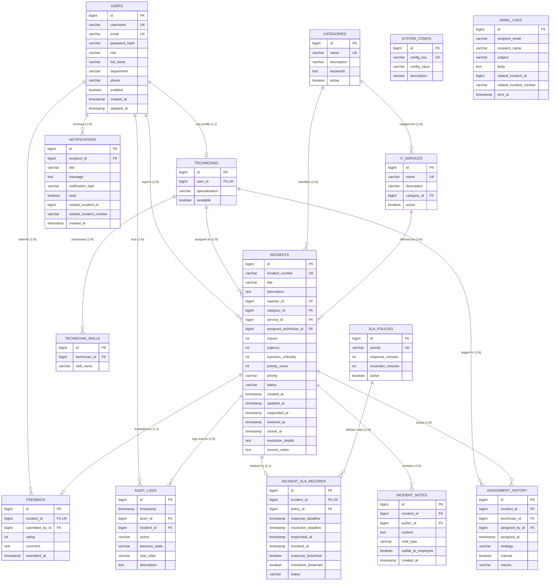

# Database Design & Schema Specification

**Course:** CS F213 / MAC F212 — Object Oriented Programming  
**Department:** Department of Computer Science & Information Systems, BITS Pilani  
**Project:** Intelligent IT Service Management & Incident Resolution System (I-ITSM)  
**Group Number:** 36  
**Faculty:** Prof. Subhrakanta Panda  
**Submission Date:** 22/11/2026  

---

The I-ITSM persistent storage is implemented using **PostgreSQL 18.x** in the `itsm_db` database. The relational schema is mapped via JPA / Hibernate entities with strict foreign keys, indexing, and cascade rules.

---

## 1. Entity-Relationship (ER) Diagram

---

## 2. Table Specifications & Relationships

1. **`users`**: Central authentication table. Roles stored as string enums (`EMPLOYEE`, `TECHNICIAN`, `ADMINISTRATOR`).
2. **`technicians`**: Profile details linked 1:1 to `users`. Manages availability state.
3. **`technician_skills`**: Composite skill tags linked via foreign key to `technicians` with `cascade = CascadeType.ALL, orphanRemoval = true`.
4. **`categories`**: Classification buckets with a `keywords` text column used by the intelligent suggestion engine.
5. **`it_services`**: Available catalog services linked to a parent category.
6. **`incidents`**: Central entity capturing the 16+ core fields, priority score, priority enum, lifecycle status enum, foreign keys to reporter, technician, category, and service.
7. **`incident_notes`**: Comments, investigation logs, and resolution details attached to incidents.
8. **`assignment_history`**: Audit trail of technician assignments and strategy attribution.
9. **`sla_policies`**: Priority-indexed policies specifying response and resolution minute windows.
10. **`incident_sla_records`**: Tracking entity computing deadlines and recording breach states.
11. **`audit_logs`**: Immutable, append-only ledger for compliance tracking.
12. **`notifications`**: User-facing in-app alerts.
13. **`feedback`**: Post-resolution employee satisfaction rating (1–5) and commentary.
14. **`system_config`**: Key-value table storing dynamic runtime parameters (such as `ASSIGNMENT_STRATEGY`).
15. **`email_logs`**: Simulated outbound email inbox for demonstration and audit review.
