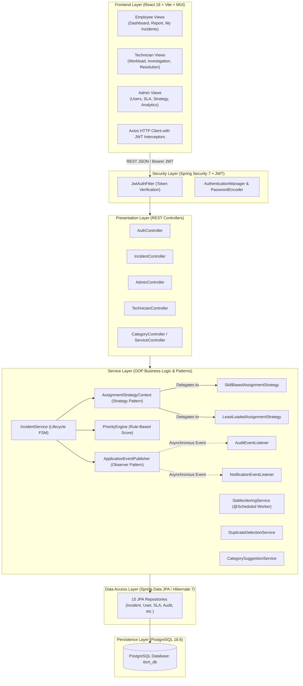
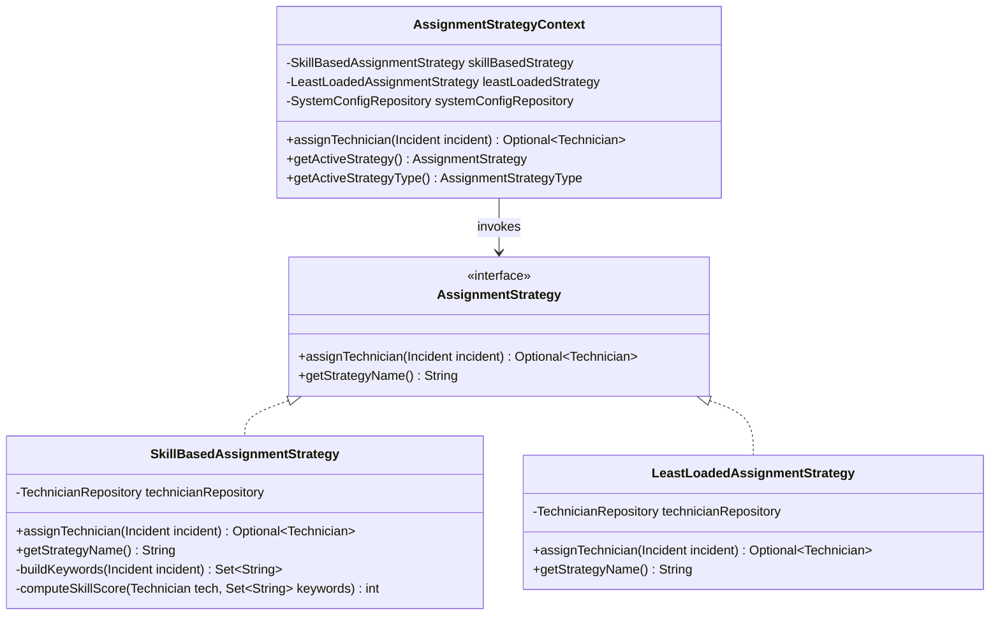
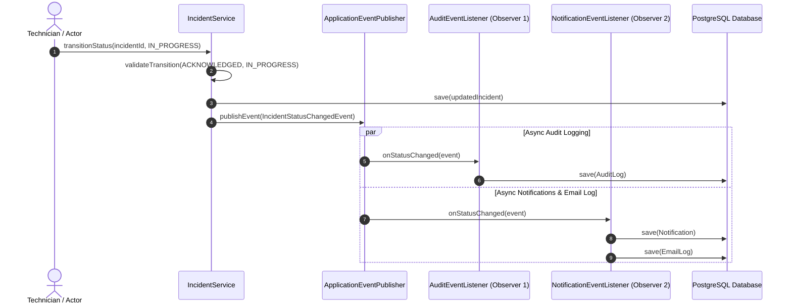
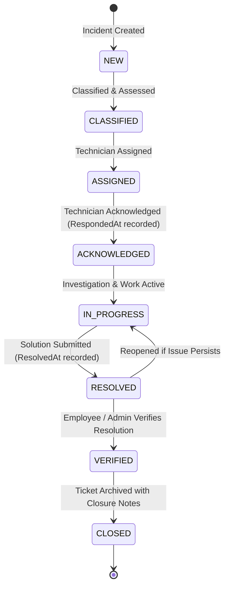

# I-ITSM Project Architecture & Object-Oriented Design

**Course:** CS F213 / MAC F212 — Object Oriented Programming  
**Department:** Department of Computer Science & Information Systems, BITS Pilani  
**Project:** Intelligent IT Service Management & Incident Resolution System (I-ITSM)  
**Group Number:** 36  
**Faculty:** Prof. Subhrakanta Panda  
**Submission Date:** 22/11/2026  

---

## 1. System Overview

I-ITSM follows an enterprise layered architecture with separation of concerns across presentation, business logic, persistence, and external communication boundaries.



---

## 2. Object-Oriented Programming (OOP) Principles Implementation

### 1. Encapsulation
- All domain entity attributes (`Incident`, `User`, `Technician`, `SlaPolicy`, etc.) are declared with `private` access modifiers.
- Mutable state modifications occur through validated domain methods and service orchestrators.
- Internal algorithms such as priority score calculation, token verification, and similarity matching are hidden from consumers behind well-defined public APIs.

### 2. Abstraction
- **Interfaces for Algorithms:** Callers interact with the `AssignmentStrategy` interface rather than concrete algorithmic implementations.
- **Service Layer Abstraction:** Controllers do not execute direct SQL or entity manipulations; they interact with coarse-grained business services (`IncidentService`, `UserService`, `TechnicianService`).

### 3. Inheritance
- Spring Security integration uses inheritance by extending `OncePerRequestFilter` inside `JwtAuthFilter`.
- `IncidentStatusChangedEvent`, `IncidentCreatedEvent`, and `IncidentAssignedEvent` inherit from Spring's `ApplicationEvent`.

### 4. Polymorphism
- The `AssignmentStrategy` interface exposes:
  ```java
  public interface AssignmentStrategy {
      Optional<Technician> assignTechnician(Incident incident);
      String getStrategyName();
  }
  ```
  Both `SkillBasedAssignmentStrategy` and `LeastLoadedAssignmentStrategy` implement this interface polymorphically. The `AssignmentStrategyContext` executes `strategy.assignTechnician(incident)` without knowing or coupling to the concrete class.
- The `GlobalExceptionHandler` polymorphic method overloading dynamically dispatches errors based on specific runtime exception signatures (`InvalidStateTransitionException`, `DuplicateResourceException`, etc.).

### 5. Composition and Aggregation
- **Composition:** `Technician` has an `@OneToMany(cascade = CascadeType.ALL, orphanRemoval = true)` relationship with `TechnicianSkill`. A `TechnicianSkill` has no independent lifecycle outside of its parent `Technician`.
- **Composition:** `Incident` owns `IncidentNote` and `IncidentSla`.
- **Aggregation:** `Incident` aggregates references to `User` (Reporter), `Technician` (Assignee), `Category`, and `ItService`. These independent entities exist prior to and beyond the incident.

---

## 3. GoF Design Patterns

### Design Pattern 1: Strategy Pattern (Technician Assignment)

**Benefits:**
- Adheres to Open-Closed Principle (OCP): new assignment algorithms (e.g., Round-Robin, Shift-Based) can be added without altering existing incident handling code.
- Runtime dynamic reconfigurability: Administrators change the active strategy without restarting the application.

### Design Pattern 2: Observer Pattern (Incident Events, Audit & Notifications)

**Benefits:**
- Decouples core incident workflow from side effects (audit logging, email simulation, user alerting).
- Non-blocking execution: Event listeners run asynchronously (`@Async`), keeping REST responses fast.

---

## 4. Finite State Machine (Incident Lifecycle)


Any attempt to skip states (e.g. `NEW` ➔ `RESOLVED` or `NEW` ➔ `CLOSED`) throws an `InvalidStateTransitionException` and returns HTTP 400.
