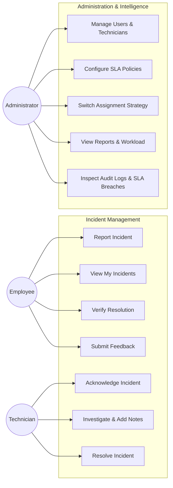

# I-ITSM System Requirements Specification

## 1. Functional Requirements

### 1.1 User & Role Management (RBAC)
- **FR-1.1:** System shall support three distinct user roles: `EMPLOYEE`, `TECHNICIAN`, and `ADMINISTRATOR`.
- **FR-1.2:** Unauthenticated users can register an `EMPLOYEE` account with username, email, full name, department, phone, and password.
- **FR-1.3:** System shall authenticate users via JWT with secure BCrypt password hashing.
- **FR-1.4:** System shall prevent duplicate usernames and emails.
- **FR-1.5:** Administrators shall have privileges to enable/disable user accounts and promote employees to technicians.

### 1.2 Incident Management & Lifecycle
- **FR-2.1:** Employees shall be able to create an incident with title, description, category, affected service, impact, urgency, and business criticality.
- **FR-2.2:** System shall auto-generate a unique incident tracking identifier matching the format `INC-YYYYMMDD-NNNN`.
- **FR-2.3:** System shall calculate rule-based priority scores:
  $$\text{Priority Score} = \text{Impact} \times \text{Urgency} \times \text{Business Criticality}$$
  with factors constrained between 1 and 3.
- **FR-2.4:** System shall enforce the strict 8-stage lifecycle:
  `NEW` ➔ `CLASSIFIED` ➔ `ASSIGNED` ➔ `ACKNOWLEDGED` ➔ `IN_PROGRESS` ➔ `RESOLVED` ➔ `VERIFIED` ➔ `CLOSED`.
- **FR-2.5:** System shall prevent illegal transitions (e.g., jumping from `NEW` to `RESOLVED`).

### 1.3 Technician Assignment Strategies (GoF Strategy Pattern)
- **FR-3.1:** System shall support Strategy A (`SKILL_BASED`), which scores available technicians based on domain keyword matches against category, service, and incident text.
- **FR-3.2:** System shall support Strategy B (`LEAST_LOADED`), which dynamically queries active (unresolved) incident counts and assigns the technician with the least active workload.
- **FR-3.3:** Administrators shall be able to toggle the active assignment strategy in runtime configuration.

### 1.4 Service Level Agreement (SLA) Management
- **FR-4.1:** System shall maintain SLA response and resolution targets per priority:
  - **P1 Critical:** Response 5 min, Resolution 30 min.
  - **P2 High:** Response 15 min, Resolution 2 hours (120 min).
  - **P3 Medium:** Response 1 hour (60 min), Resolution 8 hours (480 min).
  - **P4 Low:** Response 4 hours (240 min), Resolution 24 hours (1440 min).
- **FR-4.2:** System shall compute exact response and resolution deadlines upon incident assignment.
- **FR-4.3:** System shall continuously monitor active incidents via a background job running every 60 seconds.
- **FR-4.4:** System shall issue warning notifications when an incident is within 20% of its deadline, and record a violation breach when deadlines are exceeded.

### 1.5 Intelligent Features
- **FR-5.1 (Duplicate Detection):** System shall compare title and description tokens using Jaccard similarity across open incidents and score potential duplicates before submission.
- **FR-5.2 (Category Suggestion):** System shall analyze ticket title and description keywords against category dictionaries to suggest relevant categories automatically.

### 1.6 Audit Trail & Notifications (GoF Observer Pattern)
- **FR-6.1:** System shall publish domain events on creation, assignment, and status modification.
- **FR-6.2:** System shall maintain an append-only, immutable `audit_logs` table tracking timestamp, actor, action, previous state, new state, and description.
- **FR-6.3:** System shall generate persistent in-app notifications with read/unread tracking.
- **FR-6.4:** System shall record simulated outbound email logs in the `email_logs` table.

### 1.7 Feedback & Search/Reporting
- **FR-7.1:** Employees shall be able to submit a 1–5 star rating and comment on resolved incidents.
- **FR-7.2:** System shall provide administrative aggregate reports for status distribution, priority distribution, category distribution, SLA compliance, and technician workload.

---

## 2. Non-Functional Requirements

- **NFR-1 (Security):** Stateless JWT authentication with token expiration, BCrypt password hashing, and role checks on all non-public API endpoints.
- **NFR-2 (Performance):** Background SLA scanning running in pooled tasks; async observer listeners executing without blocking client HTTP threads.
- **NFR-3 (Data Integrity):** Foreign key constraints, unique constraints on usernames, emails, and incident numbers, and transactional rollback mechanisms.
- **NFR-4 (Usability):** Responsive React interface styled with Material UI, visual priority and status indicators, intuitive dashboards tailored per role.

---

## 3. Use Case Diagram

