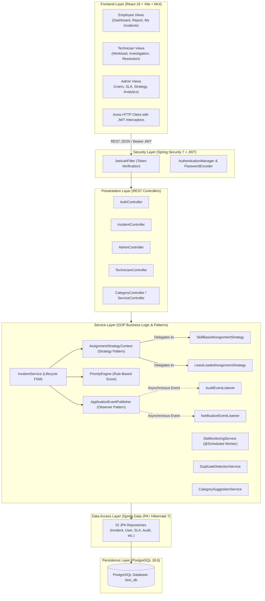
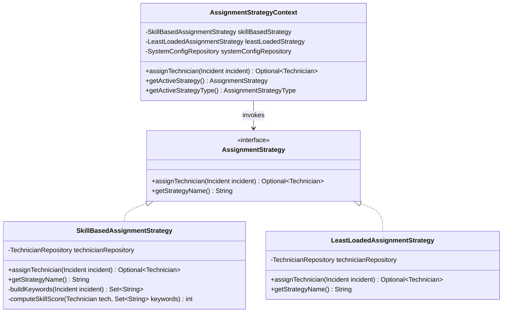
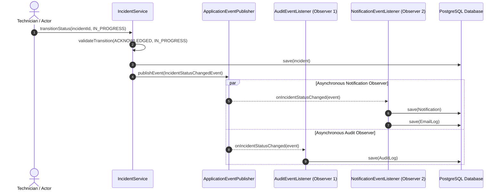
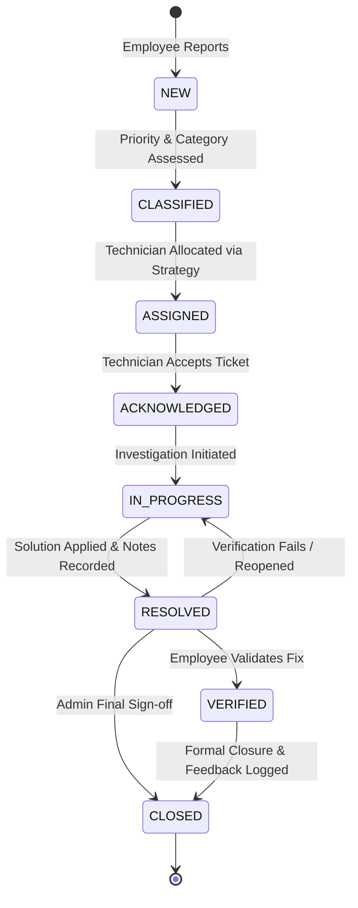

# I-ITSM Project Architecture & Object-Oriented Design

**Course:** CS F213 / MAC F212 — Object Oriented Programming  
**Department:** Department of Computer Science & Information Systems, BITS Pilani  
**Project:** Intelligent IT Service Management & Incident Resolution System (I-ITSM)  
**Group Number:** 36  
**Faculty:** Prof. Subhrakanta Panda  
**Submission Date:** 22/11/2026  

---

## 1. System Overview

I-ITSM follows an enterprise layered architecture with separation of concerns across presentation, business logic, persistence, and external communication boundaries.

---

## 2. Object-Oriented Principles Demonstration

| OOP Design Requirement | How I-ITSM Demonstrates It |
|---|---|
| **Encapsulation** | `Incident`, `User`, `Technician`, and `SlaPolicy` keep fields `private` with controlled accessors. Services manage state modifications. |
| **Abstraction** | `AssignmentStrategy.assignTechnician(Incident)` hides technician-selection logic. `IncidentService` exposes business operations. |
| **Inheritance** | `JwtAuthFilter` extends Spring Security's `OncePerRequestFilter`. Custom exceptions specialize Java runtime exception types. |
| **Polymorphism** | `AssignmentStrategyContext` calls `assignTechnician()` polymorphically on either `SkillBasedAssignmentStrategy` or `LeastLoadedAssignmentStrategy`. |
| **Interfaces** | `AssignmentStrategy` declares common contract. Spring Data JPA repository interfaces define standard data access operations. |
| **Composition** | `Technician` owns `TechnicianSkill` records with cascade and orphan removal. `Incident` owns notes and SLA records. |
| **Association** | `Incident` associates independent `User` (reporter) and `Technician` (assignee) entities. |
| **Aggregation** | `Incident` references shared catalog entities (`Category`, `ItService`) that survive incident deletion. |
| **Exception Handling** | `InvalidStateTransitionException` rejects illegal lifecycle changes. `GlobalExceptionHandler` converts exceptions to HTTP responses. |
| **Data Structures** | `Set<String>` for unique keyword tokens; `Map<IncidentStatus, Set<IncidentStatus>>` for FSM transition tables; `Optional<Technician>` for null-safe returns. |

---

## 3. GoF Design Patterns

### Design Pattern 1: Strategy Pattern (Technician Assignment)

**Benefits:**
- Adheres to Open-Closed Principle (OCP): new assignment algorithms can be added without altering existing incident handling code.
- Runtime dynamic reconfigurability: Administrators change the active strategy without restarting the application.

### Design Pattern 2: Observer Pattern (Incident Events, Audit & Notifications)

**Benefits:**
- Loose coupling: `IncidentService` does not need direct references to notification or audit services.
- Extensibility: Adding a new listener (e.g., WebhookEventListener, SlackAlertListener) requires zero modifications to `IncidentService`.

---

## 4. Finite State Machine (Incident Lifecycle)

