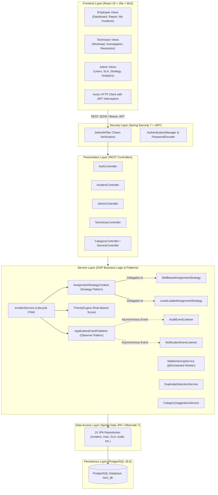
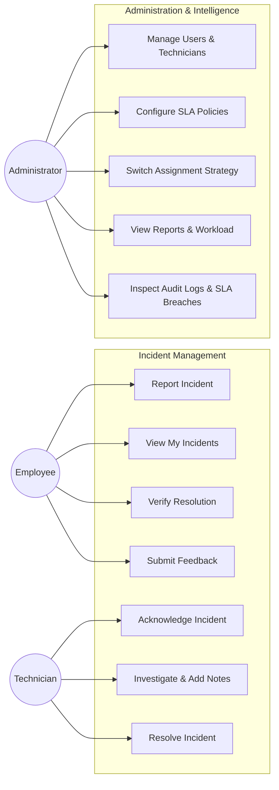
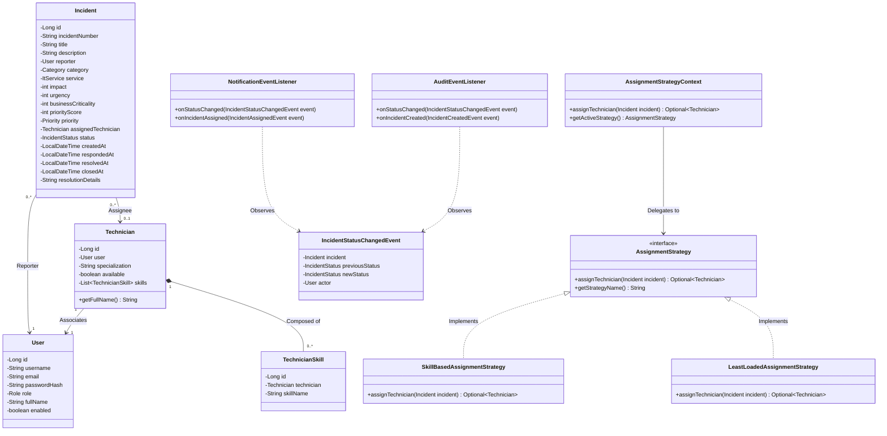
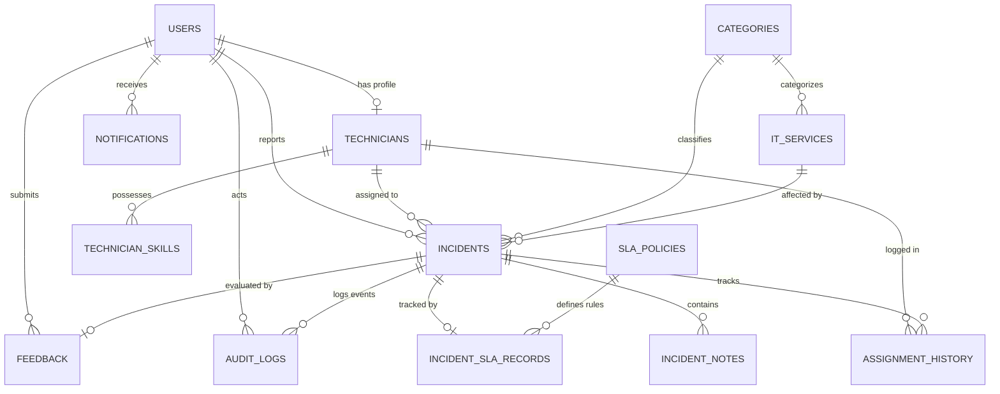
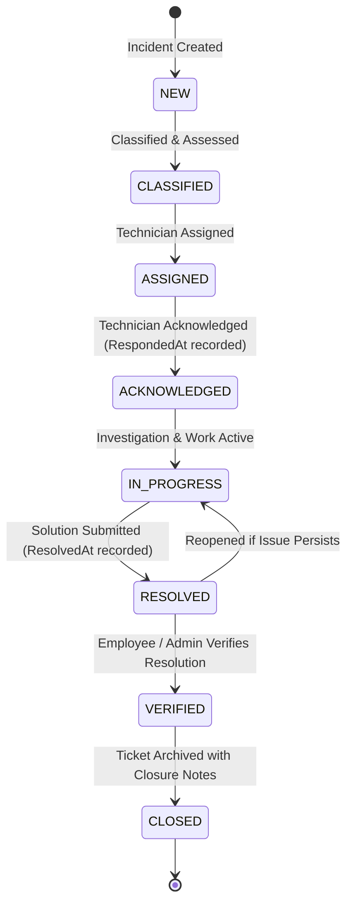

# I-ITSM UML Diagrams Reference

This document gathers all visual architectural, behavior, and design pattern diagrams for I-ITSM.

---

## 1. System Architecture Diagram

---

## 2. Use Case Diagram

---

## 3. Class Diagram (Core Domain Model & GoF Patterns)

---

## 4. Entity-Relationship (ER) Diagram

---

## 5. Incident Lifecycle State Transition Diagram

